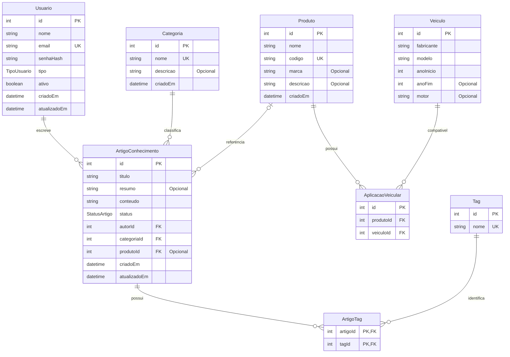

# Diagrama Entidade-Relacionamento (DER)

## Smart-Base AutoParts

O banco de dados utiliza PostgreSQL e Prisma ORM. O modelo possui oito entidades principais, responsáveis por organizar usuários, categorias, produtos, veículos, aplicações veiculares, artigos técnicos e tags.

## 1. Diagrama

O diagrama utiliza a sintaxe Mermaid, que pode ser renderizada diretamente pelo GitHub.

## 2. Descrição das entidades

| Entidade | Responsabilidade |
|---|---|
| Usuario | Armazena os usuários responsáveis pelo sistema e pela criação dos artigos. |
| Categoria | Organiza os artigos por assunto ou área técnica. |
| Produto | Armazena informações sobre peças e produtos automotivos. |
| Veiculo | Registra fabricantes, modelos, anos e motores dos veículos. |
| AplicacaoVeicular | Relaciona produtos aos veículos compatíveis. |
| ArtigoConhecimento | Armazena os artigos técnicos e suas informações. |
| Tag | Armazena palavras-chave para facilitar a classificação dos artigos. |
| ArtigoTag | Relaciona artigos às respectivas tags. |

## 3. Relacionamentos

- **Usuario e ArtigoConhecimento:** um usuário pode escrever vários artigos. Cada artigo possui um autor.
- **Categoria e ArtigoConhecimento:** uma categoria pode classificar vários artigos. Cada artigo pertence a uma categoria.
- **Produto e ArtigoConhecimento:** um produto pode estar associado a vários artigos. A associação do produto ao artigo é opcional.
- **Produto e Veiculo:** relacionamento muitos-para-muitos, implementado pela entidade AplicacaoVeicular.
- **ArtigoConhecimento e Tag:** relacionamento muitos-para-muitos, implementado pela entidade ArtigoTag.

## 4. Integridade e normalização

O modelo utiliza:

- Chaves primárias para identificar os registros.
- Chaves estrangeiras para manter a integridade referencial.
- Restrições de unicidade para e-mail, código de produto e nomes de categoria e tag.
- Chaves primárias compostas na tabela ArtigoTag.
- Restrição de unicidade composta em AplicacaoVeicular, impedindo a repetição de uma mesma associação entre produto e veículo.
- Índices para otimizar consultas frequentes.
- Regras de integridade referencial para controlar exclusões e atualizações.

## 5. Enums

O sistema utiliza dois tipos enumerados:

**TipoUsuario**
- ADMIN
- COLABORADOR

**StatusArtigo**
- RASCUNHO
- PUBLICADO
- ARQUIVADO

## 6. Tecnologia de implementação

A estrutura foi implementada utilizando Prisma ORM, com PostgreSQL como banco de dados relacional. O Prisma Schema representa as entidades, os campos, os relacionamentos, as restrições e os índices utilizados pelo sistema.